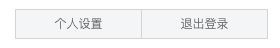
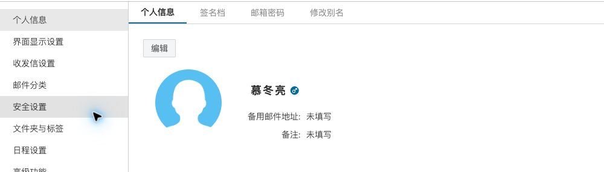
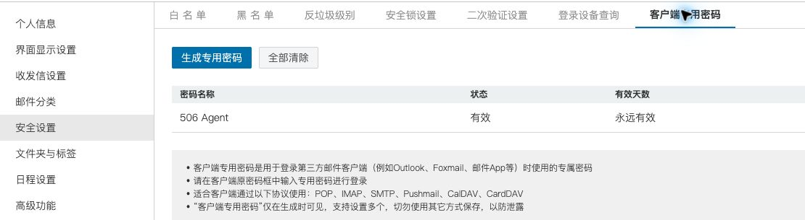

# 华科邮箱客户端专用密码获取指南

使用 hust-mail-cli 前，先在华科邮箱网页端生成客户端专用密码，再将完整邮箱地址和专用密码填写到本机配置中。客户端使用专用密码登录，不使用网页登录密码。

## 进入个人设置

1. 打开[华科邮箱](https://mail.hust.edu.cn)，登录自己的账号。
2. 点击页面左上角头像，在展开的菜单中选择 **个人设置**。



## 打开安全设置

进入个人设置后，首先看到 **个人信息** 页面。点击左侧的 **安全设置**。



## 选择客户端专用密码

在安全设置顶部选择 **客户端专用密码** 标签。

完整路径：**头像 → 个人设置 → 安全设置 → 客户端专用密码**。



图中的 **506 Agent** 是已有专用密码的名称，状态为“有效”。这个名称用于区分设备或用途，**不是密码内容**；你可以为自己的设备取其他名称。

## 生成并记住专用密码

1. 点击 **生成专用密码**，按网页提示完成操作。
2. 生成后自行记住页面显示的专用密码。网页提示：**专用密码仅在生成时可见**。
3. 将专用密码填写到邮件客户端的密码字段，不要填写“506 Agent”等密码名称。

不要将密码发到群聊、截图分享或提交到代码仓库。以上截图只展示入口和已有条目，不包含密码，也没有演示实际生成过程。

## 填写 CLI 配置

在仓库根目录执行以下命令，复制配置模板；已有配置不会被覆盖：

```sh
mkdir -p ~/.config/hust-mail-cli
cp -n config.example.json ~/.config/hust-mail-cli/config.json
chmod 700 ~/.config/hust-mail-cli
chmod 600 ~/.config/hust-mail-cli/config.json
```

编辑 `~/.config/hust-mail-cli/config.json`，只需替换以下两项，保留模板中的其他字段：

```json
{
  "user": "你的完整邮箱@hust.edu.cn",
  "password": "网页端生成的专用密码"
}
```

上面的 JSON 仅展示需要填写的字段；完整模板见 [config.example.json](../config.example.json)。配置以明文保存在本机，请保持 `0600` 权限。

服务器已预填为：

| 用途 | 主机 | TLS 端口 | 当前行为 |
| --- | --- | --- | --- |
| IMAP 收信 | `mail.hust.edu.cn` | `993` | 只读收信，不修改已读状态或删除远端邮件 |
| SMTP 发信 | `mail.hust.edu.cn` | `465` | `send` 使用专用密码认证发送 |

安装 CLI 后，可列出文件夹验证连接：

```sh
hust-mail-cli folders
```

如果只通过 `make` 构建而尚未安装，在仓库根目录使用 `./bin/hust-mail-cli folders`。

更多配置、同步范围及命令示例见 [配置指南](configuration.md)与[命令参考](command-reference.md)。
